# Лабораторна робота 04. Реалізація бази даних для вебпроєкту

ПІБ: Конашук Владислав Сергійович
Група: ІПЗ-21
Склад команди: 1 особа (В.Конашук)
Тема проєкту: Інтернет магазин: Лимон
Репозиторій: https://github.com/rotdreamz/laboratorna04

## 1. Особистий внесок

Роботу виконано повністю самостійно:

- спроєктовано схему БД SQLite з 5 таблицями;
- реалізовано CRUD для відгуків, товарів, замовлень і клієнтів;
- реалізовано каталог, кошик та оформлення замовлення;
- зв'язок замовлень і товарів через проміжну таблицю `order_items`;
- керування статусами замовлень в адмін-панелі;
- адмін-панель для відгуків, товарів, замовлень і клієнтів;
- **рівень 2:** таблиця `clients`, її керування в адмін-панелі та інтеграція в застосунок: при оформленні замовлення клієнт шукається за email або створюється автоматично;
- додатково: картинки товарів (за посиланням), вартість доставки, акційна ціна з вибором кольору, україномовні підписи статусів, дизайн сайту.

Коміти:
Коміти:
- [Додано схему БД і моделі](https://github.com/rotdreamz/laboratorna04/commit/a984111): схема БД і CRUD-функції
- [Додано маршрути відгуків](https://github.com/rotdreamz/laboratorna04/commit/183ce28): відгуки
- [Додано магазин і кошик](https://github.com/rotdreamz/laboratorna04/commit/9b43848): каталог, кошик, оформлення замовлення
- [Додано адмін-маршрути для товарів, замовлень і клієнтів](https://github.com/rotdreamz/laboratorna04/commit/ad02dac): адмін-панель, таблиця клієнтів (рівень 2)
- [Додано HTML-шаблони сайту й адмін-панелі](https://github.com/rotdreamz/laboratorna04/commit/ce2ae80): шаблони
- [Оновлено стилі: лимонна тема й картки каталогу](https://github.com/rotdreamz/laboratorna04/commit/ddc1332): дизайн сайту

Уся історія комітів: https://github.com/rotdreamz/laboratorna04/commits/main

## 2. Схема бази даних

|    Таблиця    | Призначення                                              | Ключі |
|---------------|----------------------------------------------------------|---------|
| `feedback`    | відгуки користувачів                                     | PK `id` |
| `clients`     | клієнти                                                  | PK `id`, `email` UNIQUE |
| `products`    | товари (ціна, акційна ціна, доставка, картинка, залишок) | PK `id` |
| `orders`      | замовлення зі статусом                                   | PK `id`, FK `client_id` → `clients.id` |
| `order_items` | позиції замовлення                                       | PK `id`, FK `order_id` → `orders.id`, FK `product_id` → `products.id` |

Зв'язки:
- `clients` → `orders`: один-до-багатьох (`ON DELETE RESTRICT`, клієнта із замовленнями видалити не можна);
- `orders` ↔ `products`: багато-до-багатьох через `order_items` (`order_id` має `ON DELETE CASCADE`, `product_id` має `ON DELETE RESTRICT`).

Зовнішні ключі працюють, бо після кожного підключення виконується `PRAGMA foreign_keys = ON`. Усі запити параметризовані (`?`), що захищає від SQL-ін'єкцій. Після змін даних викликається `commit()`, а з'єднання закривається в `teardown_appcontext`.

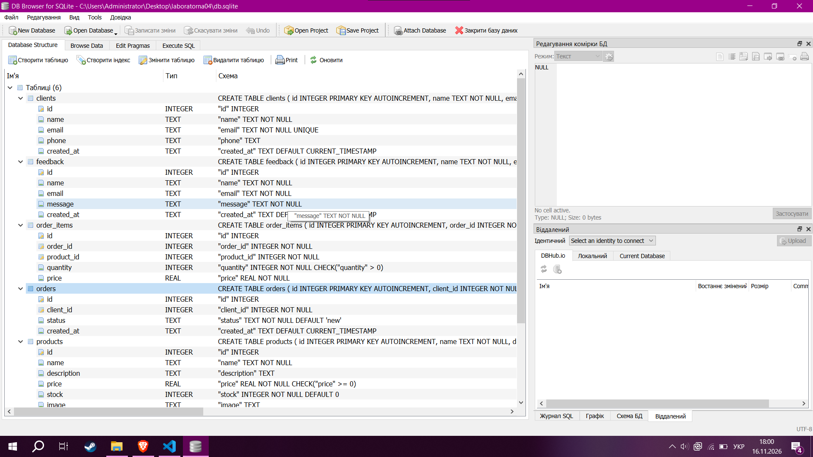
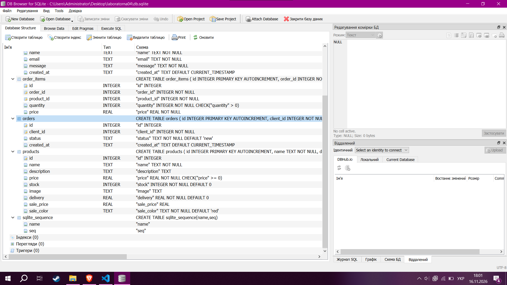

## 3. Скріншоти

**Каталог**

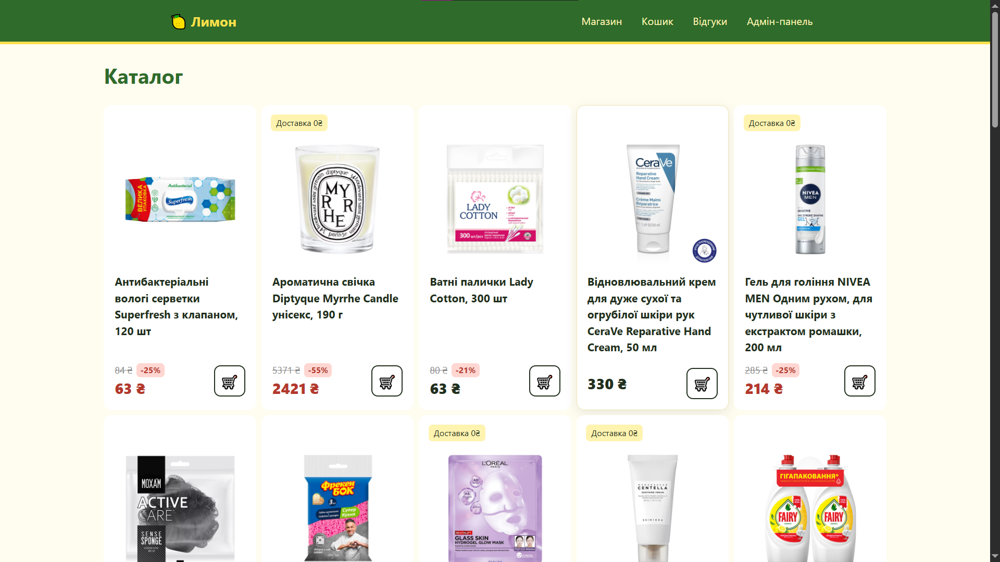
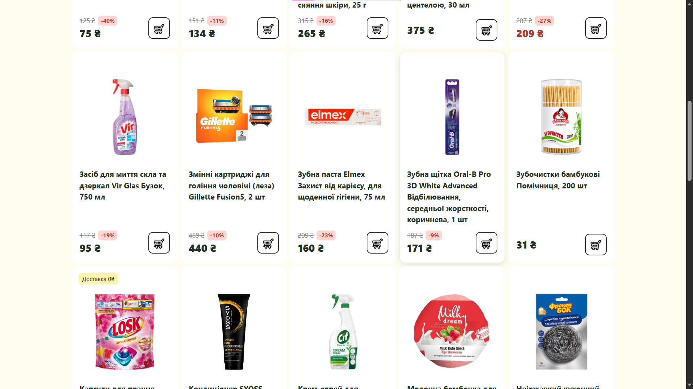
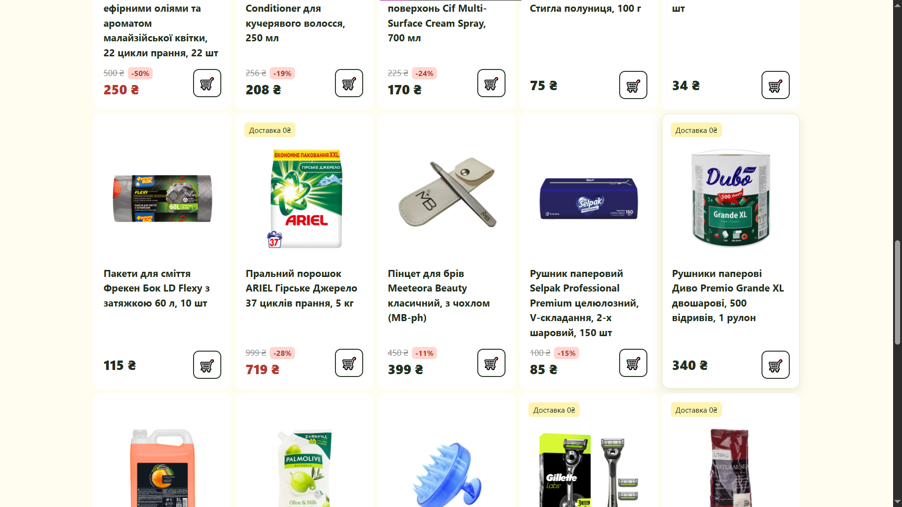

**Адмін-панель: товари**

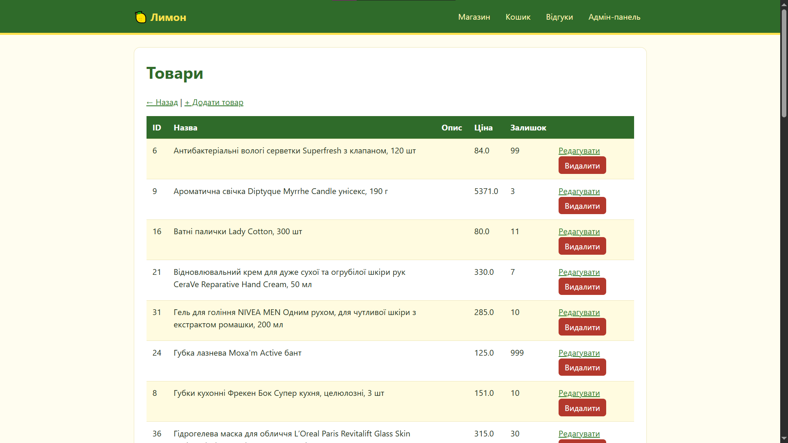
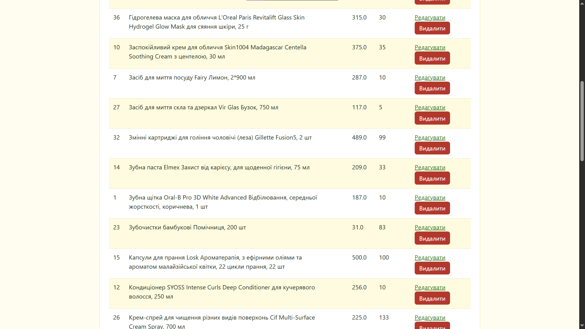

**Форма товару**

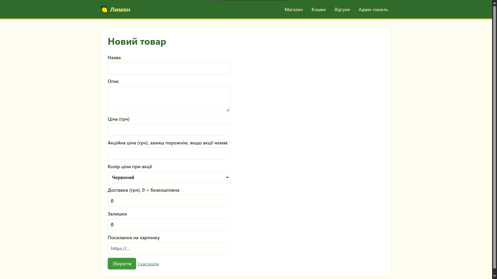

**Адмін-панель: замовлення зі статусами**

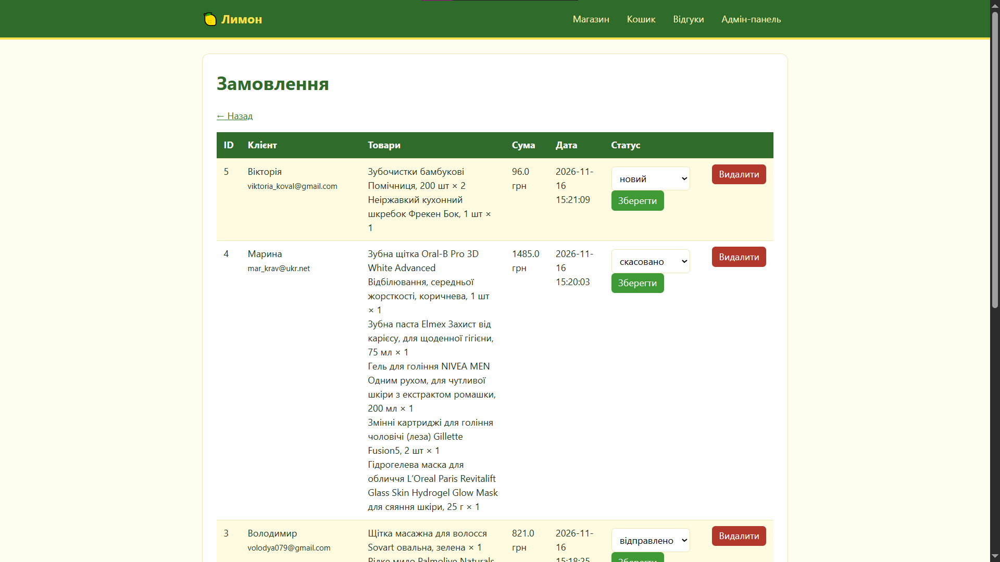
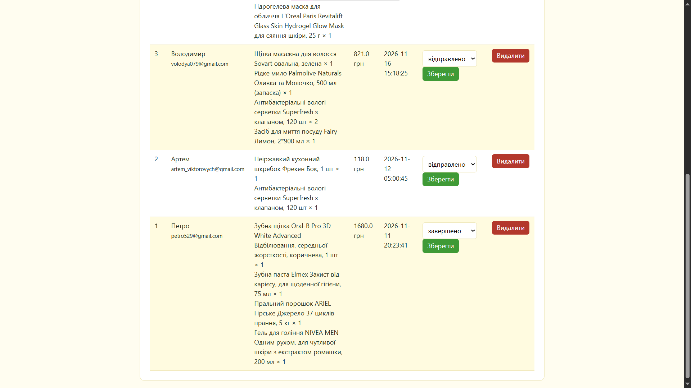

**Адмін-панель: клієнти (рівень 2)**

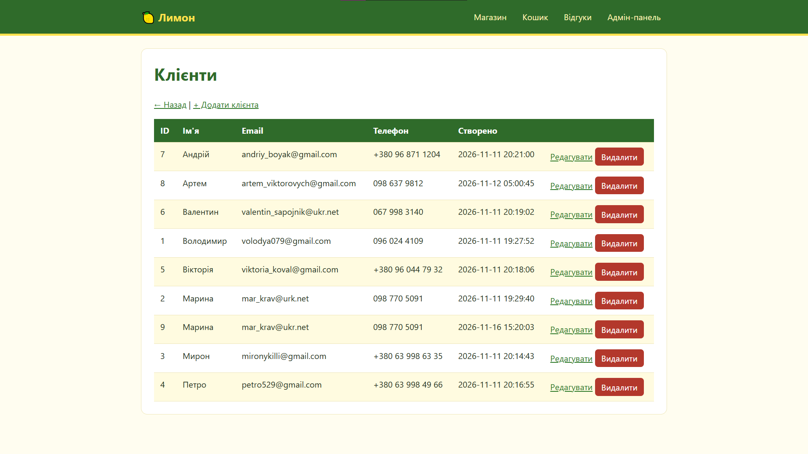

**Адмін-панель: відгуки**

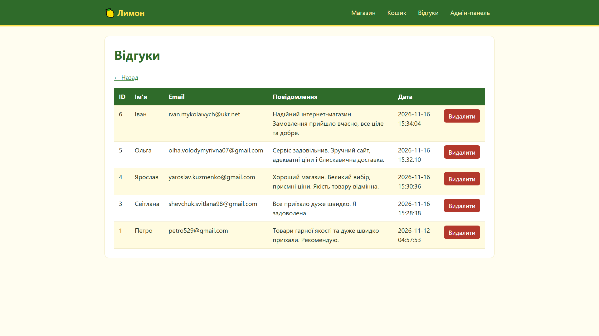

**Захист цілісності: клієнта із замовленнями видалити не можна**

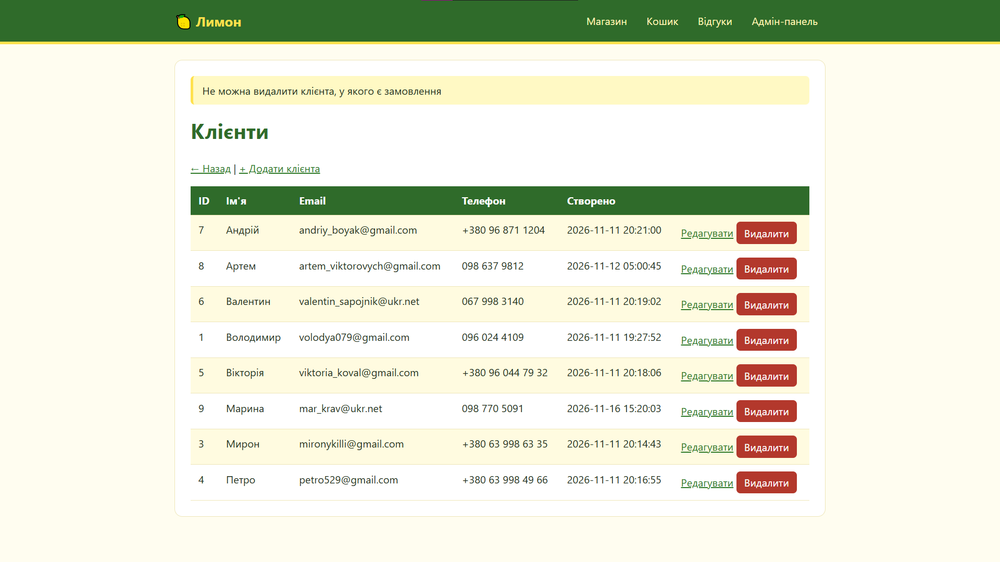

## 4. Труднощі та їх вирішення

- PowerShell блокував активацію віртуального середовища → виконав `Set-ExecutionPolicy -Scope CurrentUser RemoteSigned`.
- Папка проєкту була завантажена як ZIP і не була підключена до Git → склонував репозиторій.
- У `.gitignore` рядок `db.sqlite` мав пробіл на початку й не працював → прибрав відступ.
- Після додавання нових колонок у `products` виникала помилка `no such table` / `no such column`, бо `CREATE TABLE IF NOT EXISTS` не змінює наявну таблицю → видаляв `db.sqlite`, і база створювалась наново.
- Розмітка форми товару була зламана вкладеним `<label>` → виправив структуру.

## 5. Висновки

У ході роботи я створив базу даних SQLite для Flask-застосунку, реалізував CRUD-операції та зв'язки між таблицями, захист від SQL-ін'єкцій через параметризовані запити та контроль цілісності через зовнішні ключі. Додаткова таблиця «Клієнти» інтегрована в процес оформлення замовлення й керується з адмін-панелі. Я навчився працювати з Git і GitHub, робити осмислені коміти й готувати проєкт до здачі.