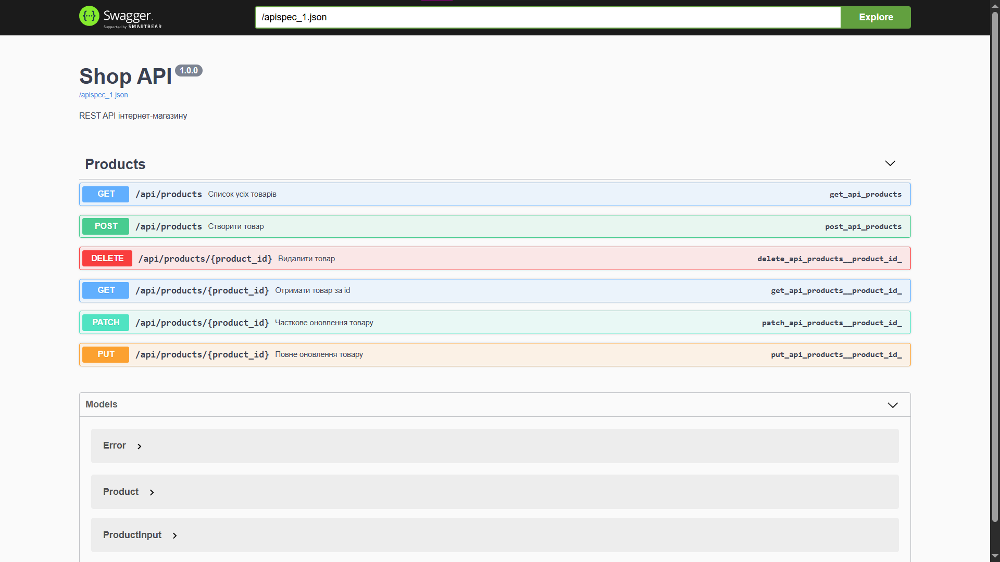
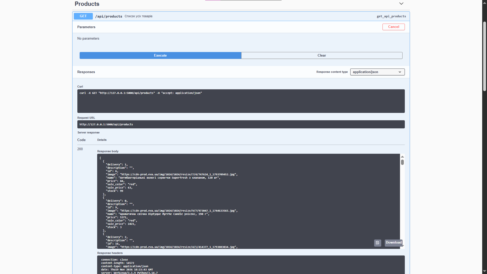
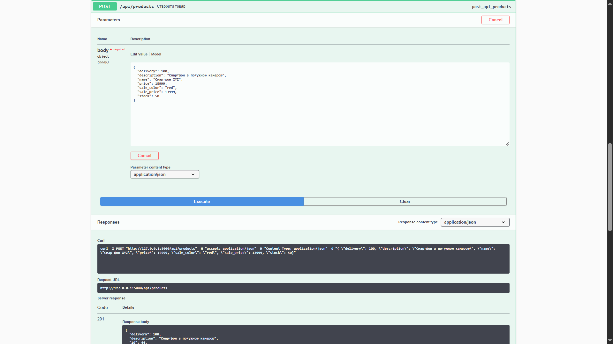
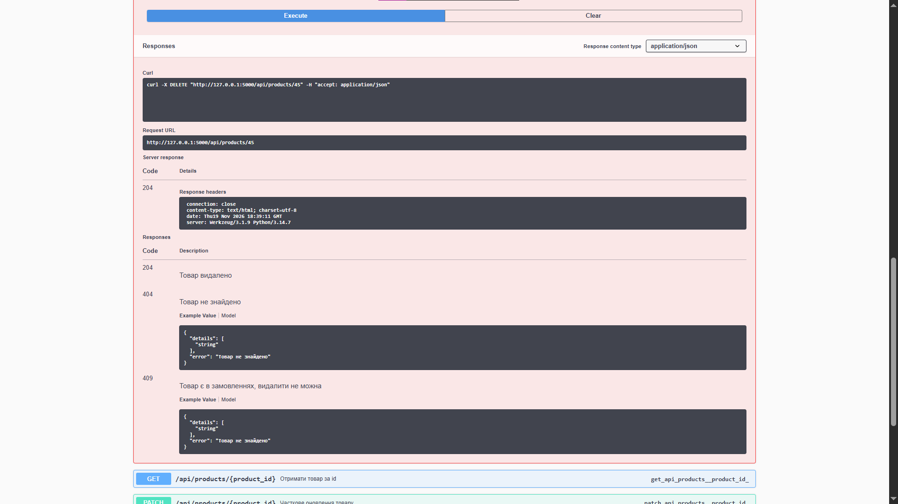
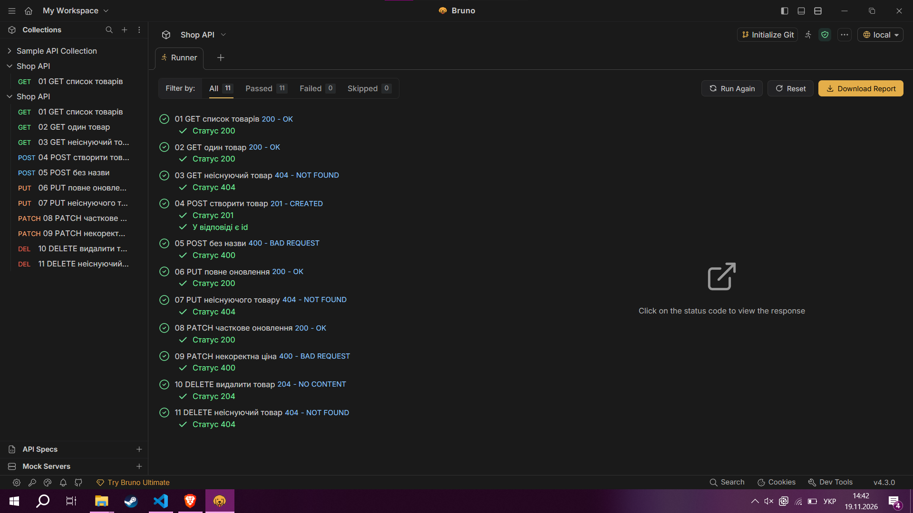
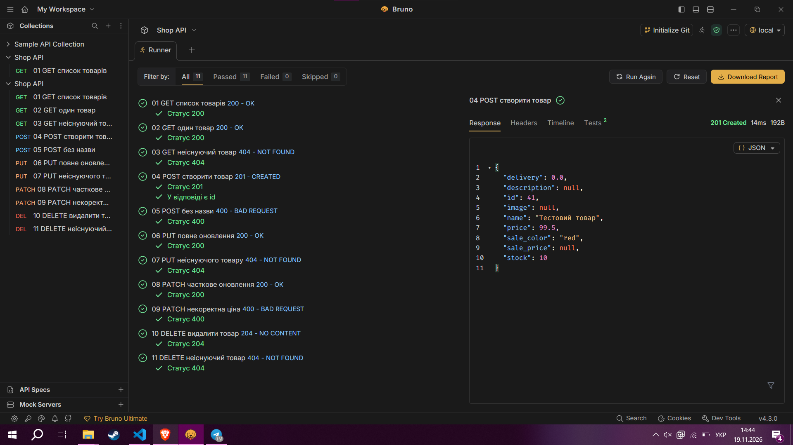
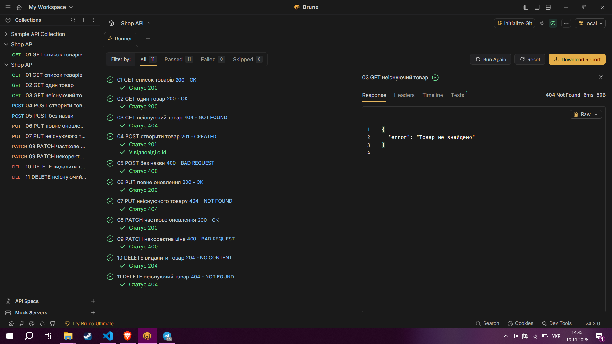

# Лабораторна робота 05. Розробка RESTful API з документацією

ПІБ: Конашук Владислав Сергійович
Група: ІПЗ-21
Склад команди: 1 особа (В.Конашук)
Тема проєкту: Інтернет магазин: Лимон
Репозиторій: https://github.com/rotdreamz/laboratorna05

## 1. Особистий внесок

Роботу виконано індивідуально на основі проєкту лабораторної роботи 4 (копія проєкту, новий репозиторій). **Під час виконання я використовував ШІ-асистента Claude** як помічника: він пропонував структуру API, код `routes/api.py`, налаштування flasgger і тестову колекцію, а також підказував кроки роботи з Git та Bruno. Весь код я вставляв у проєкт, запускав, перевіряв і виправляв самостійно (див. розділ «Труднощі»).

Що зроблено:

- створено новий репозиторій і гілку `laboratorna5` на основі проєкту лабораторної 4;
- **рівень 1:** розроблено REST API для товарів (6 endpoints) з форматом JSON і обробкою помилок;
- **рівень 1:** створено колекцію тестів у Bruno (11 запитів: успішні сценарії та сценарії з помилками), експортовано у `postman_collection.json`, зафіксовано результати тестування;
- **рівень 2:** підключено flasgger, описано всі endpoints, схеми запитів і відповідей та приклади (сторінка `/apidocs/`);
- **рівень 3 (частково):** реалізовано валідацію вхідних даних і обробку помилок з кодами статусу; версіонування API не реалізовано;
- змінено назву сайту у вкладці браузера на «Лимон».

Коміти:

- `додано flask і flagger`: залежності, оновлено `requirements.txt`;
- `додано REST API для товарів і документацію flasgger`: `routes/api.py`, зміни в `app.py` і `models.py`;
- `додано колекцію тестів API`: `postman_collection.json`.

Уся історія комітів: https://github.com/rotdreamz/laboratorna05/commits/main

## 2. Опис API і технології

REST API розширює застосунок із лабораторної 4 і керує ресурсом **товари** (`products`): перегляд, створення, повне й часткове оновлення, видалення. Дані передаються у форматі JSON, для результатів і помилок використовуються відповідні HTTP-коди. API реалізовано окремим Blueprint `api_bp` з префіксом `/api` у файлі `routes/api.py`, а для роботи з базою використано готові функції з `models.py` (SQLite, параметризовані запити).

Технології: Python 3, Flask 3.1, SQLite, flasgger (Swagger UI), Bruno, Git і GitHub, Visual Studio Code.

Запуск:

```
python -m venv venv
venv\Scripts\activate
pip install -r requirements.txt
python app.py
```

Сайт: `http://127.0.0.1:5000/`, API: `http://127.0.0.1:5000/api/products`, документація: `http://127.0.0.1:5000/apidocs/`.

## 3. Таблиця endpoints

| № | Метод | Адреса | Призначення | Коди відповідей |
|---|-------|--------|-------------|-----------------|
| 1 | GET | `/api/products` | список усіх товарів | 200 |
| 2 | GET | `/api/products/<id>` | один товар за id | 200, 404 |
| 3 | POST | `/api/products` | створити товар | 201, 400 |
| 4 | PUT | `/api/products/<id>` | повне оновлення товару | 200, 400, 404 |
| 5 | PATCH | `/api/products/<id>` | часткове оновлення товару | 200, 400, 404 |
| 6 | DELETE | `/api/products/<id>` | видалити товар | 204, 404, 409 |

Код 409 повертається, коли товар уже є в замовленнях: у схемі БД `product_id` має `ON DELETE RESTRICT`, тому такий товар видалити не можна.

Приклад запиту (POST `/api/products`):

```json
{
  "name": "Смартфон XYZ",
  "price": 15999,
  "stock": 50,
  "delivery": 100,
  "sale_price": 13999,
  "sale_color": "red"
}
```

Приклад відповіді (201 Created):

```json
{
  "id": 4,
  "name": "Смартфон XYZ",
  "description": null,
  "price": 15999,
  "stock": 50,
  "image": null,
  "delivery": 100,
  "sale_price": 13999,
  "sale_color": "red"
}
```

## 4. Валідація та обробка помилок

Валідація (функція `validate_product` у `routes/api.py`):

- тіло запиту має бути JSON-об'єктом, інакше 400;
- `name`: непорожній рядок (обов'язкове для POST і PUT);
- `price`: число не менше 0 (обов'язкове для POST і PUT);
- `stock`: ціле число не менше 0;
- `delivery`, `sale_price`: число не менше 0;
- значення `true/false` не приймаються як числа;
- для PATCH приймаються лише дозволені поля, порожній набір полів дає 400.

Усі помилки API повертаються у форматі JSON:

```json
{ "error": "Помилка валідації", "details": ["price: потрібне число >= 0"] }
```

Обробники помилок 404, 405 і 500 спрацьовують лише для адрес, що починаються з `/api/`, тому звичайні HTML-сторінки магазину працюють як раніше.

## 5. Документація API (рівень 2)

Документацію створено бібліотекою flasgger: опис кожного endpoint задано YAML у docstring функції, а схеми `Product`, `ProductInput` і `Error` визначено в `app.py`. На сторінці `/apidocs/` працює кнопка **Try it out**.

**Загальний вигляд**



**GET: список товарів (200)**



**POST: створення товару (201)**



**DELETE: видалення товару (204)**



## 6. Тестування в Bruno (рівень 1)

Створено колекцію з 11 запитів: для кожного endpoint є успішний сценарій і сценарій з помилкою, а в кожен запит додано автоматичну перевірку коду відповіді. Запит №4 зберігає `id` створеного товару у змінну `productId`, яку використовують запити 6, 8, 9 і 10, тому тестування не чіпає реальні товари магазину. Колекцію експортовано у `postman_collection.json` (формат Postman v2.1).

| № | Запит | Метод і адреса | Очікуваний код | Результат |
|---|-------|----------------|----------------|-----------|
| 1 | Список товарів | GET `/api/products` | 200 | пройдено |
| 2 | Один товар | GET `/api/products/1` | 200 | пройдено |
| 3 | Неіснуючий товар | GET `/api/products/9999` | 404 | пройдено |
| 4 | Створити товар | POST `/api/products` | 201 | пройдено |
| 5 | Створити без назви | POST `/api/products` | 400 | пройдено |
| 6 | Повне оновлення | PUT `/api/products/{id}` | 200 | пройдено |
| 7 | PUT неіснуючого | PUT `/api/products/9999` | 404 | пройдено |
| 8 | Часткове оновлення | PATCH `/api/products/{id}` | 200 | пройдено |
| 9 | PATCH з ціною -5 | PATCH `/api/products/{id}` | 400 | пройдено |
| 10 | Видалити товар | DELETE `/api/products/{id}` | 204 | пройдено |
| 11 | Видалити неіснуючий | DELETE `/api/products/9999` | 404 | пройдено |

Підсумок запуску колекції: 11 з 11 перевірок пройдено, 0 помилок.

**Результат запуску колекції**



**Успішний запит (POST, 201)**



**Запит з помилкою (GET неіснуючого товару, 404)**



## 7. Труднощі та їх вирішення

- Після копіювання проєкту лабораторної 4 у новий репозиторій старе віртуальне середовище не працювало → видалив `venv` і `.git` у копії, створив нове середовище й ініціалізував новий репозиторій.
- При вставці коду `routes/api.py` рядок розірвався, і Flask видав `SyntaxError: unterminated string literal` → виправив рядок з лапками.
- `ImportError: cannot import name 'get_all_products'`: у `api.py` був неправильний імпорт, а в `models.py` під час правки було пошкоджено розділ товарів → виправив імпорт і відновив функції `get_all_products`, `get_product`, `update_product`, `delete_product`.
- `git push` видав `Could not resolve host: github.com` → причиною була мережа, після відновлення з'єднання повторив `push`.
- У формі створення запиту в Bruno назва потрапляла в поле URL і ламала запит → замість ручного створення 11 запитів імпортував готову колекцію з `postman_collection.json`.
- Вкладка браузера мала стару назву «Кав'ярня» → змінив `<title>` у `templates/base.html` на «Лимон».

## 8. Висновки

У ході роботи я розробив REST API для ресурсу «товари» вебзастосунку на Flask із базою SQLite: реалізовано методи GET, POST, PUT, PATCH і DELETE з коректними кодами відповідей (200, 201, 204, 400, 404, 405, 409, 500), валідацію вхідних даних і єдиний формат помилок у JSON. Я протестував API в Bruno (11 сценаріїв, усі пройдено) і створив інтерактивну документацію за допомогою flasgger. Я навчився проєктувати ендпоінти за принципами REST, використовувати Blueprint, писати тестові сценарії й документувати API. Під час роботи я використовував ШІ-асистента Claude як допоміжний інструмент, а результат перевіряв самостійно.